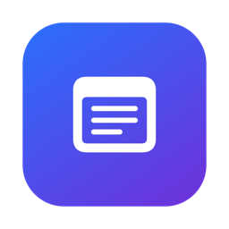
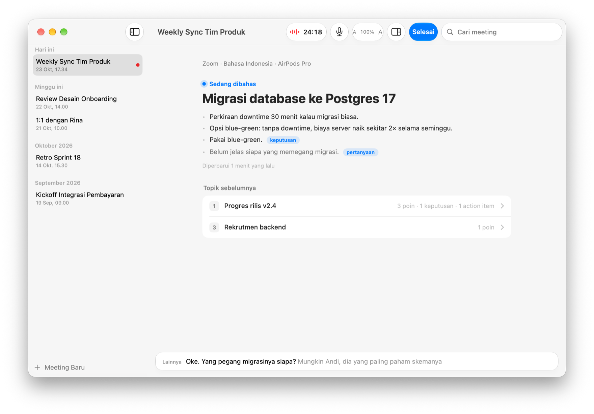
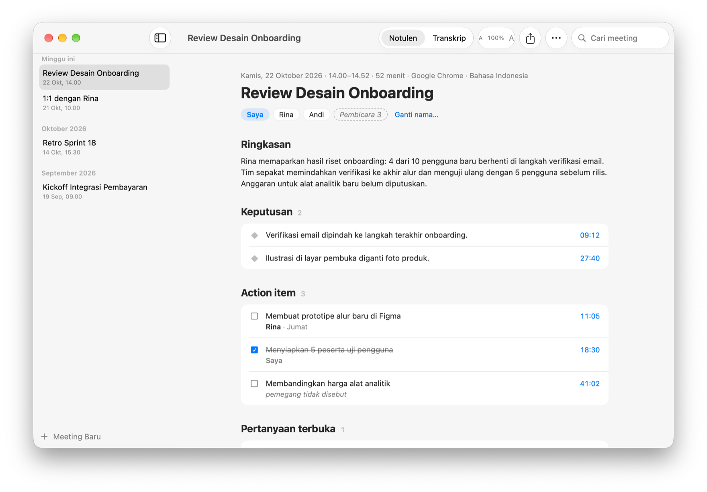

<p align="center">
  
</p>

<h1 align="center">Notulen</h1>

<p align="center">
  <strong>Meeting selesai. Notulennya juga.</strong>
</p>

<p align="center">
  Notulen merekam meeting online, menuliskan setiap kalimat di Mac kamu,<br>
  dan menyusun notulen berbahasa Indonesia begitu kamu menekan Selesai.
</p>

<p align="center">
  <picture>
    <source media="(prefers-color-scheme: dark)" srcset="docs/images/live-dark.png">
    
  </picture>
</p>

---

## Selama meeting

### Selalu tahu apa yang sedang dibahas.

Catatan sementara disusun per topik dan diperbarui sekitar setiap dua
setengah menit. Topik yang sedang berjalan tampil besar di tengah. Keputusan,
action item, dan pertanyaan terbuka langsung diberi label. Topik sebelumnya
terlipat rapi di bawahnya.

- **Kalimat terakhir, selalu terlihat.** Strip kaca di bawah menampilkan apa
  yang baru diucapkan. Kata yang masih dikenali tampil lebih pudar.
- **Transkrip lengkap di samping.** Buka dengan ⌥⌘T. Panelnya ikut bergulir,
  kecuali kamu sedang membaca bagian atas.
- **"Saya" dan "Lainnya" sejak detik pertama.** Suara app meeting dan mic kamu
  direkam di dua jalur terpisah, jadi suaramu tidak pernah tertukar.
- **Mic bisa dimatikan sendiri.** Mute di Zoom lalu bicara dengan orang di
  ruangan? Tekan ⇧⌘M. Obrolan itu tidak masuk transkrip, sementara audio
  meeting tetap terekam.

## Setelah meeting

### Notulen yang langsung bisa dipakai.

Satu sampai dua menit setelah kamu menekan Selesai, notulennya siap:
ringkasan, keputusan, action item, pertanyaan terbuka, dan topik yang dibahas.
Notulen selalu ditulis dalam Bahasa Indonesia, apa pun bahasa meetingnya.

<p align="center">
  <picture>
    <source media="(prefers-color-scheme: dark)" srcset="docs/images/minutes-dark.png">
    
  </picture>
</p>

- **Tidak mengarang.** Pemegang dan tenggat hanya diisi kalau memang
  diucapkan. Kalau tidak, notulen menulis "pemegang tidak disebut".
- **Setiap poin punya waktunya.** Klik penanda waktu biru, dan transkrip
  terbuka tepat di kalimat itu.
- **Centang yang sudah beres.** Action item bisa dicentang, dan centangnya
  tersimpan.
- **Kurang pas? Buat ulang.** Notulen bisa ditulis ulang kapan saja dari
  transkrip yang sama.

### Tahu siapa bicara apa.

Setelah meeting, suara dari app meeting dipisah menjadi Pembicara 1, 2, 3, dan
seterusnya. Proses ini berjalan sepenuhnya di Mac. Beri mereka nama dengan
bantuan saran nama dari AI, atau gabungkan dua pembicara yang ternyata orang
yang sama. Notulen langsung ikut berubah.

### Satu notulen, banyak bahasa.

Terjemahkan notulen ke Inggris, Mandarin, Jepang, Korea, Arab, Belanda,
Jerman, Prancis, Spanyol, atau bahasa lain lewat kodenya. Setiap terjemahan
disimpan, dan kamu bisa berpindah bahasa kapan saja.

### Kirim ke mana pun.

- **Salin sebagai Markdown.** Heading, daftar, dan kotak centang tetap rapi
  saat ditempel ke Notion, Obsidian, atau email.
- **Ekspor PDF.** Ukuran A4, multi-halaman, dan teksnya bisa dipilih.
- **Kirim ke Notion.** Setiap notulen menjadi satu halaman. Kalau dikirim
  lagi, halaman yang sama diperbarui, bukan dibuat baru.

Ekspor selalu mengikuti bahasa yang sedang tampil.

## Privasi

### Suaramu tetap di Mac kamu.

- **Transkripsi dan pemisahan pembicara berjalan di Mac.** Audio tidak pernah
  dikirim ke mana pun.
- **Audio tidak pernah ditulis ke disk.** Audio meeting hanya disimpan di
  memori sampai pembicara selesai dipisah, lalu dihapus.
- **Sidik suara tidak disimpan.** Pemisahan pembicara tidak meninggalkan data
  biometrik.
- **Yang keluar hanya teks.** Transkrip dikirim ke penyedia AI pilihanmu, dan
  notulen ke Notion kalau kamu mengirimnya. Ingin semuanya tetap di Mac? Pakai
  [Ollama](https://ollama.com).
- **Kunci API ada di Keychain.** Tidak pernah di file biasa.

## Ketahanan

### Dibuat untuk meeting tiga jam.

- **Tidak ada kalimat yang hilang.** Setiap kalimat final langsung disimpan.
  Kalau app crash atau listrik padam, paling banyak beberapa detik terakhir
  yang hilang. Saat dibuka lagi, pilih **Lanjutkan merekam** atau
  **Selesaikan dan buat notulen**.
- **Mac tetap terjaga.** Selama merekam, Mac tidak tidur sendiri. Kalau tetap
  tidur kurang dari 15 menit, rekaman lanjut sendiri. Kalau lebih lama,
  Notulen bertanya dulu, supaya dua meeting tidak tersambung jadi satu.
- **Ganti headset kapan saja.** Mic pindah ke perangkat baru dalam sekitar
  satu detik, dan transkrip tetap berjalan.
- **Peringatan yang penting.** Kalau suara meeting keluar lewat speaker Mac
  dan bisa masuk ke mic, Notulen memberi tahu.
- **Tahu kapan meeting usai.** Kalau app meeting ditutup atau meeting sunyi 10
  menit, Notulen menawarkan untuk menyelesaikan rekaman. Rekaman tidak pernah
  dihentikan tanpa persetujuanmu.
- **Internet putus?** Transkrip tetap berjalan, dan catatan sementara menyusul
  begitu koneksi kembali.

## Dirancang untuk Mac

Notulen dibuat dengan komponen SwiftUI bawaan macOS 26, dengan Liquid Glass,
mode gelap, dan satu warna aksen. Ukuran teks catatan, transkrip, dan notulen
bisa diatur dari 85% sampai 240% lewat menu, tombol A/A di toolbar, atau
pinch di trackpad.

| Pintasan | Fungsi |
| --- | --- |
| ⌘N | Meeting baru |
| ⇧⌘M | Matikan atau nyalakan mic |
| ⌥⌘T | Tampilkan atau sembunyikan transkrip |
| ⌘+ / ⌘− / ⌘0 | Perbesar, perkecil, atau kembalikan ukuran teks |
| ⌘, | Pengaturan |

## Spesifikasi teknis

| | |
| --- | --- |
| **Sistem** | macOS 26 atau lebih baru |
| **Sumber audio** | Satu app meeting (Zoom, Teams, Google Meet di browser, dan lainnya) atau semua audio sistem. Mic selalu direkam di jalur terpisah. |
| **Bahasa meeting** | Semua bahasa yang didukung pengenalan suara macOS, satu bahasa per meeting |
| **Bahasa notulen** | Bahasa Indonesia, dengan terjemahan ke bahasa lain |
| **Pengenalan suara** | SpeechAnalyzer, di Mac, dengan kosakata kustom untuk nama dan istilah |
| **Pemisahan pembicara** | FluidAudio dengan model pyannote community-1, di Mac |
| **AI** | Claude (bawaan): Haiku 5.5 untuk catatan sementara, Sonnet 5.5 untuk notulen dan terjemahan. Bisa juga OpenAI, Google Gemini, DeepSeek, Groq, OpenRouter, Ollama, atau server lain yang kompatibel dengan OpenAI. |
| **Ekspor** | Markdown, PDF (A4), Notion |
| **Penyimpanan** | JSON di `~/Library/Application Support/rakyat.notulen` |
| **Perkiraan biaya AI** | Meeting 3 jam dengan Claude: sekitar $0,35–0,55. Terjemahan sekitar $0,05–0,10 per bahasa. Harga per Oktober 2026. |

## Instal

Notulen dibangun dari kode sumber dengan Command Line Tools. Xcode tidak
diperlukan.

### Yang dibutuhkan

- macOS 26 atau lebih baru
- Command Line Tools dengan Swift 6.2 atau lebih baru: `xcode-select --install`
- [xcbeautify](https://github.com/cpisciotta/xcbeautify) untuk merapikan
  keluaran build: `brew install xcbeautify`
- Koneksi internet sekali, untuk mengunduh model pemisahan pembicara. Setelah
  itu model dibundel di dalam app, dan app tidak pernah mengunduh apa pun saat
  berjalan.

### Pasang

```sh
make install
```

Perintah ini membangun versi release lalu menyalinnya ke
`/Applications/Notulen.app`. Buka Notulen dari Launchpad, Spotlight, atau
Dock. Jalankan lagi setelah mengubah kode. Karena app ditandatangani secara
lokal, macOS mungkin meminta izin mic dan perekaman audio lagi setelah setiap
pemasangan.

## Mulai

1. **Pilih AI.** Buka Pengaturan (⌘,), pilih penyedia AI, lalu tempel kunci
   API-nya. Ollama berjalan di Mac dan tidak perlu kunci.
2. **Mulai meeting.** Tekan ⌘N, beri judul, pilih sumber audio dan bahasa,
   lalu tekan **Mulai**.
3. **Beri izin.** Izinkan mic, perekaman audio sistem, dan pengenalan suara
   saat macOS memintanya.
4. **Pakai headset.** Supaya suara peserta lain tidak masuk ke mic dan
   terlabel "Saya".
5. **Tekan Selesai.** Notulennya siap dalam satu sampai dua menit.

### Menghubungkan Notion

1. Buat integrasi internal di
   [notion.so/profile/integrations](https://www.notion.so/profile/integrations),
   lalu salin tokennya.
2. Bagikan halaman induk ke integrasi itu: menu halaman, **Connections**,
   tambahkan integrasinya.
3. Di Pengaturan, tab Notion, tempel token dan URL halaman induk.

## Untuk developer

```sh
make build      # build debug, dibundel dan ditandatangani di .build/Notulen.app
make run        # build debug, lalu buka app-nya
make test       # jalankan test; make test FILTER='SpeakerTests|HTMLTests' untuk sebagian
make install    # build release ke /Applications/Notulen.app
make uninstall  # hapus app dari /Applications (meeting kamu tetap ada)
make models     # unduh ulang model pemisahan pembicara
make icon       # gambar ulang App/Support/AppIcon.icns
```

Build pertama menjalankan `make models` sendiri kalau model belum ada.

```text
App/
  Audio/         audio app meeting (Core Audio process tap), mic, buffer di memori
  Speech/        pengenalan suara di Mac
  Diarization/   pemisahan pembicara (FluidAudio)
  AI/            klien penyedia AI, catatan sementara, notulen, terjemahan
  Meeting/       sesi rekaman, jurnal transkrip, aturan tidur dan bangun, penyelesaian meeting
  Export/        Markdown, PDF, Notion
  UI/            tampilan SwiftUI
  Store/         model Codable, penyimpanan JSON, Keychain, pengaturan
  Support/       Info.plist, entitlement, ikon app
Tests/           unit test
prompts/         template prompt dalam Bahasa Indonesia
scripts/         pengunduh model, pembuat ikon
docs/            desain, rencana, dan gambar README
Models/          model pemisahan pembicara hasil unduhan (tidak masuk git)
```

- Desain lengkap: [docs/superpowers/specs/2026-10-22-notulen-design.md](docs/superpowers/specs/2026-10-22-notulen-design.md)
- Catatan kerja untuk kode, termasuk batasan tanpa Xcode: [CLAUDE.md](CLAUDE.md)
- Prompt AI ada di [prompts/](prompts/) sebagai template Markdown dengan
  `{{variabel}}`. Prompt disetel untuk Claude, jadi model lain bisa menjawab
  sedikit berbeda.

## Atribusi

Pemisahan pembicara memakai [FluidAudio](https://github.com/FluidInference/FluidAudio)
(Apache-2.0) dan model pyannote community-1 (CC-BY-4.0) dari pyannote,
WeSpeaker, BUT Speech@FIT, dan Fluid Inference. Atribusi yang sama ada di
halaman Tentang di app.

---

<p align="center">
  <sub><em>Notulen</em> adalah kata Indonesia untuk catatan rapat.</sub>
</p>
